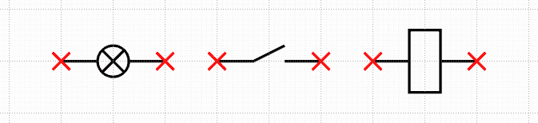

# Refusal of responsibility

This software is distributed on an "AS IS" BASIS, WITHOUT WARRANTIES OR CONDITIONS OF ANY KIND, either express or implied.

# Description

Among the main features, this editor is oriented to what kind of window is currently active. 
Scheme is currently selected in the treeview is less important.

This means:
* For example, if activate window with 3D view, the buttons associated with schematics workbench is will go out. 
It doesn't matter what scheme is currently selected in treeview, the main thing is which window is currently active.
* Another example, if copy objects and paste it. Objects will be pasted into the window that is currently active. 
It doesn't matter what scheme is selected in the treeview.

It is important to note: if select an object in document treeview, then the window (tab) with a scheme in where 
this object located is automatically activates.

Not supported features:
* A convenient and fast way to make a copy of an existing sheet is not available yet.

## Main concepts

The workbench allows to create sheets for drawing schematics. 
The scheme is a set of symbols (Conventional Graphic Designation) connected with lines (wires).

Each symbol has a pins - areas for connecting wires, just like a real electronic component or electrical apparatus has contacts for connecting wires.



## Add / Delete features

### Create new scheme

Press button  with drawing paper and green plus on toolbar.

### Add new symbols

Activate window with scheme and press symbol button.
Also, is possible to change position and rotation of symbol by context menu or from property's tab.

### Draw wires

Press the wire button  and left-click on the sheet
to place vertices; the ends snap to symbol pins when close enough. Double-click or press Enter to finish, Escape or
right-click to cancel. Wires are first-class document objects: they are saved with the file, appear in the tree, can be
selected, moved and deleted like any other element, and carry a `WireType` (Power, Control, Hydraulic, Pneumatic, Signal)
plus per-wire stroke style (StrokeWidth / StrokeDash) in the property tab.

### Designators and values

Symbols carry KiCad-style `Designator` (K1, R3) and `Value` fields in the property tab.
On placement a symbol is annotated automatically when its library entry defines a reference
prefix (`schematics:ref`, set in the symbol manager's pin editor - `Resistor` ships with `R`).
The **Annotate sheet** command fills any remaining empty designators without collisions.
The designator is drawn above the symbol and the value below it; the value stays hidden
while it equals the library name, exactly like KiCad's default fields.

### Print and PDF

**File → Print / Print preview** (Ctrl+P) renders the sheet exactly as drawn - page size and
orientation follow the sheet's template (A4/A3, portrait/landscape), fitted without distortion.
**Export PDF…** writes the same rendering to a PDF file.

### Component list

**Component list…** lists every annotated symbol of the sheet (designator, value, symbol,
description) with CSV export and clipboard copy - the device list a machine schematic is
delivered with. Rows are ordered naturally (R1, R2, R10); symbols without a designator are
covered by **Annotate sheet** first.

### Delete symbol(s)

Select symbol(s) in sheet or in treeview. Press delete key on keyboard.

## Copy / Paste features

### Copy symbol(s)

Select symbol or a few symbols. 
Press right mouse button and select a 'Copy' from context menu or select a 'Edit → Copy' main menu item. 
Activate window which contain scheme sheet where to insert symbols. 
Press right mouse button and select a 'Paste' from context menu or select a 'Edit → Paste' main menu item. 
Symbols copied by context menu will be pasted to current mouse cursor position. 
Symbols pasted through the 'Edit → Paste' main menu item, will be pasted to the same place where they copied.

### Copy a full scheme sheet

This feature not fully supported yet. To make right duplicate of scheme select sheet with all elements,
and Copy and Paste it.

## Sheet customizing features

### Sheet grid

To enable/disable the sheet grid, select scheme in treeview of document and press 
 button on toolbar. 
Also, this feature can be enabled by changing the 'Show Grid' property through the property editor.

### Sheet grid customizing

There are two types of grids: major (coarse) and minor (fine). 
For each of them, is possible to adjust the lines width and lines color by the properties window.

### Snap to grid feature

To enable/disable snap to grid, select scheme in treeview of document and press 
 button on toolbar. 
Also, this feature can be enabled by changing the 'Snap Enabled' property through the property editor.

### Change grid spacing

The grid spacing can be set by changing the 'Grid Spacing' property. 
It is also possible to enable a snap to the major grid by changing scheme 'Snap To Major Grid' property.

Note: if specify zero as the grid line width, then the grid line width will be 1 pixel ever, independently of the sheet scale.

### Sheet blueprint displaying mode

This feature allows to represent the scheme in inverted colors.
To change displaying mode, select scheme in treeview of document and set 'Invert colors' property.

## Script examples

For run examples, at first activate Schematics workbench after that copy given code and paste it to FreeCAD Python console.

First script example is creates a empty sheet and generate a 5x5 grid from symbols.

```python
Gui.runCommand('SCNewScheme',0)
for x in range(0,5):
    for y in range(0,5):
        Gui.runCommand('SCLamp',0)
        l = Gui.ActiveDocument.ActiveObject
        l.Object.X = 70 + x * 20
        l.Object.Y = 50 + y * 20
        Gui.runCommand('SCCoil',0)
        r = Gui.ActiveDocument.ActiveObject
        r.Object.X = 80 + x * 20
        r.Object.Y = 60 + y * 20
        r.Object.Rotation.Value = 90

#END
```

Next example shows how to customize scheme sheet grid after creation:

```python
Gui.runCommand('SCNewScheme',0)
sheet = Gui.ActiveDocument.ActiveObject

# Change view properties (presented in View tab)
sheet.Visibility = True

# Change data properties (presented in Data tab)
sheetData = sheet.Object
sheetData.ViewObject.GridVisible = True
sheetData.ViewObject.GridSpacing = '1.00 mm'
sheetData.MajorGridLineEvery = 10
sheetData.MajorGridLineColor = (0.00,0.00,1.00) # Blue
sheetData.MajorGridLineStyle = 2 # Dash style
sheetData.MinorGridLineColor = (1.00,0.00,0.00) # Red
sheetData.MinorGridLineStyle = 1 # Solid style
#END
```

# Development

## Keyboard shortcuts (KiCad-compatible)

The sheet view follows the KiCad schematic editor's default hotkeys so muscle memory transfers:

| Key | Action |
| --- | --- |
| `A` | Place symbol… (chooser: search, preview, pin list) |
| `W` | Draw wire |
| `R` / `Shift+R` | Rotate selection 90° counter-clockwise / clockwise |
| `X` / `Y` | Mirror selection horizontally / vertically |
| `T` | Add text |
| `I` | Add line |
| `Del` | Delete selection |
| `Esc` | Cancel active tool (wire, placement) / clear selection |
| `Home` | Zoom to fit the sheet |
| `Enter` / double-click | Finish wire, place the chosen symbol |
| `Ctrl+E` | Symbol manager (pin editor opens directly for the selected symbol) |
| `Ctrl+C/X/V`, `Ctrl+Z/Y` | Clipboard and undo/redo (FreeCAD defaults) |

Hotkeys are declared as the `Accel` resource on each command and only fire while a
scheme window is active. FreeCAD's shortcut manager still allows rebinding them.
Keys for features that do not exist yet (junction `J`, labels `L`, no-connect `Q`,
properties dialog `E`, cursor-follow move `M`) are deliberately not bound.

* `python install.py` copies the workbench into FreeCAD's user Mod directory (restart FreeCAD afterwards).
* Type check: `python -m mypy Init.py InitGui.py SCUtils.py Schematics verify_freecad.py verify_imports.py` — must stay clean.
* Lint: `ruff check .` — rules are pinned in `pyproject.toml` (ruff's defaults have broadened across releases).
* Editor language servers: `pyrightconfig.json` points basedpyright at `./.venv` (Python 3.11, FreeCAD/PySide6 stubs),
  `typings/` supplies a stub for FreeCAD's bundled `pivy` module, and `.zed/settings.json` keeps Zed's default servers
  while disabling save-time reformatting. Diagnostics mirror mypy's leniency on purpose: remaining
  `reportAttributeAccessIssue` warnings mark legacy dynamic FreeCAD-property access, not known bugs.
* End-to-end: `FreeCAD.exe verify_freecad.py` (15 steps) and `FreeCADCmd.exe verify_imports.py`.